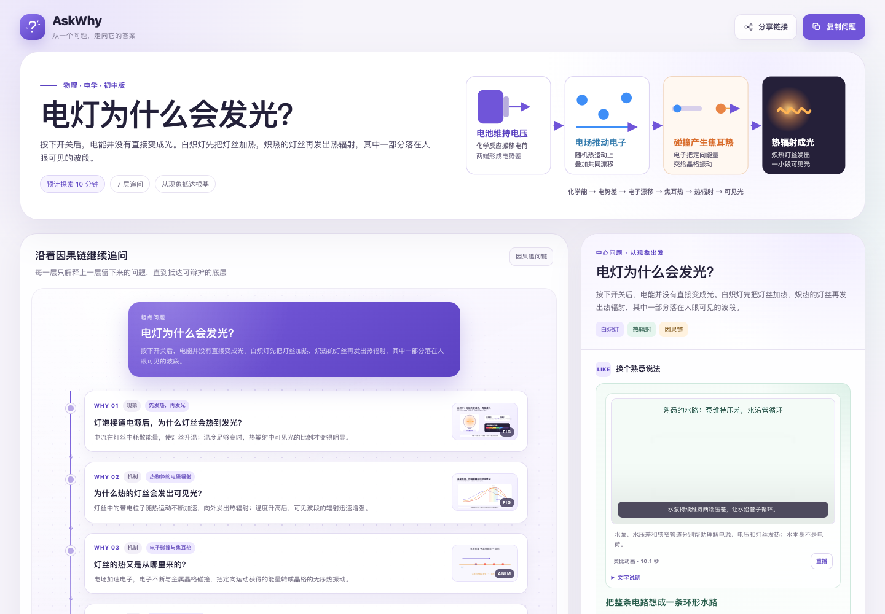

# AskWhy + DeepWhy Skills

Two OpenMAIC-inspired, analogy-first agent skills for turning complex questions
into portable, interactive learning pages.

[AskWhy](skills/askwhy/SKILL.md) is the recommended starting point. It follows
one question through a focused 4–8 step causal chain, pairing every abstract
mechanism with a familiar analogy and continuing until a foundational principle
or an honest evidence boundary. The generated page works as one standalone HTML
file without an account, backend, or AskWhy application.

[DeepWhy](skills/deepwhy/SKILL.md) is the advanced workflow for questions that
need multiple causal branches, interactive labs, larger assessments, or a more
elaborate teaching sequence.

<p align="center">
  <a href="skills/askwhy/examples/bulb-glow.html">
    
  </a>
</p>

<p align="center">
  <sub>AskWhy example: “电灯为什么会发光？” Follow the causal ladder from
  current and voltage through electron collisions and Joule heating to thermal
  radiation and visible light.
  <a href="skills/askwhy/examples/bulb-glow.html">Open the full example</a>.</sub>
</p>

## Why AskWhy

AskWhy starts from an observable phenomenon, asks why the remaining causal gap
occurs, and continues one link at a time. Every layer receives a complete detail
panel, a stage-appropriate analogy with explicit mappings and boundaries, and an
SVG or Manim visual when the mechanism benefits from one. Video discovery uses
bounded Bilibili and YouTube search, reviewed inline videos, and an external
fallback; unchanged Manim scenes reuse a source-hash cache.

Before generation, AskWhy asks for one learning stage (`小学` / `初中` / `高中`)
and then one deliverable (`只生成知识页` or `知识页 + 讲解视频`), with the
knowledge page selected by default. Both choices are selectable options rather
than free-form prompts. When video export is selected, AskWhy hands the completed
content and visual assets to the HyperFrames video workflow.

## What AskWhy creates

- A linear 4–8 step why-chain from phenomenon to mechanism, principle, theory,
  frontier, or honest evidence boundary.
- A numbered causal ladder with complete previous/next navigation and one
  detail panel per question.
- A familiar, stage-appropriate analogy at every layer, including explicit
  concept mappings and a note about where the analogy stops being accurate.
- Explanatory SVG diagrams and short Manim animations, with motion-heavy
  mechanisms defaulting to Manim.
- Up to two reviewed videos per node from the platforms reachable on the
  current network, plus a branded fallback when inline playback is unavailable.
- A single shareable HTML file with all CSS, JavaScript, diagrams, and media
  embedded. No account, backend, analytics, or runtime dependency is required.

See [skills/askwhy/SKILL.md](skills/askwhy/SKILL.md) for the complete workflow.

### DeepWhy for advanced questions

DeepWhy adds explicit causal branches, same-chain `all` / `any` cause groups,
hands-on labs, five-question checks per detailed node, compact follow-up nodes,
and staged expansion tooling. Use it when a single linear why-chain is too
small for the learning goal.

## Install

### Codex

```bash
git clone https://github.com/deepwhy/deepwhy-skill.git
mkdir -p ~/.codex/skills
cp -R deepwhy-skill/skills/askwhy ~/.codex/skills/askwhy
cp -R deepwhy-skill/skills/deepwhy ~/.codex/skills/deepwhy
```

Windows PowerShell:

```powershell
git clone https://github.com/deepwhy/deepwhy-skill.git
New-Item -ItemType Directory -Force "$HOME\.codex\skills"
Copy-Item -Recurse -Force "deepwhy-skill\skills\askwhy" "$HOME\.codex\skills\askwhy"
Copy-Item -Recurse -Force "deepwhy-skill\skills\deepwhy" "$HOME\.codex\skills\deepwhy"
```

Recommended invocation:

```text
$askwhy 电灯为什么会发光？
```

For an advanced multi-cause page, use:

```text
$deepwhy 为什么计算机使用补码？
```

### Other agent runtimes

The skills are not tied to Codex. AskWhy is the recommended interface and lives
at [skills/askwhy](skills/askwhy); DeepWhy remains available at
[skills/deepwhy](skills/deepwhy). Each directory is self-contained with its
`SKILL.md`, `references/`, `scripts/`, and `assets/`.

- If your agent supports `SKILL.md`, install `skills/askwhy` into that runtime's
  skill directory. Directory names vary by product, so follow the runtime's own
  installation convention. Install `skills/deepwhy` as well for advanced pages.
- If it supports `AGENTS.md`, clone this repository and work inside it; the root
  [AGENTS.md](AGENTS.md) routes knowledge-explainer requests to DeepWhy.
- If it has no Skill mechanism, point it at the files directly:

```text
Read skills/askwhy/SKILL.md and follow it to generate an interactive,
standalone HTML causal why-chain for this question: <question>
```

`agents/openai.yaml` is optional Codex interface metadata. Other runtimes can
ignore it.

## Requirements

- Python 3.10+ for validation and page building.
- Node.js 20+ only when running the optional Playwright browser test.
- Manim is Manim-first for explanatory motion when already installed. The Skill
  probes it once and asks for explicit confirmation before installing a missing
  isolated runtime; otherwise it uses SVG/SMIL fallback.
- External papers and embedded videos require network access. The generated
  HTML itself works offline.

## Generate an AskWhy page

From the AskWhy Skill directory:

```bash
python3 scripts/validate_content.py examples/bulb-glow.json
python3 scripts/build_page.py \
  examples/bulb-glow.json \
  --output /tmp/bulb-glow.html
```

The example keeps its source JSON at
[bulb-glow.json](skills/askwhy/examples/bulb-glow.json) and its generated page
at [bulb-glow.html](skills/askwhy/examples/bulb-glow.html).

## Advanced DeepWhy generation

For multi-node pages, the Skill first locks the whole linear route, probes video
platform reachability once, then writes resumable bundles for the first 3
detailed nodes:

```bash
python3 skills/deepwhy/scripts/pipeline.py init --frame frame.json
python3 skills/deepwhy/scripts/pipeline.py check-node WORKSPACE nodes/n1.json
python3 skills/deepwhy/scripts/pipeline.py status WORKSPACE
python3 skills/deepwhy/scripts/pipeline.py finalize WORKSPACE --output page.html
```

Independent node bundles can be authored in parallel. A failed node is corrected
without regenerating the rest of the page.

Continue one compact node from an existing page or exported JSON:

```bash
python3 skills/deepwhy/scripts/chain_expand.py inspect page.html
python3 skills/deepwhy/scripts/chain_expand.py patch page.html patch.json \
  --output page.html --json-out page.json
```

The page keeps stable node IDs and local backups. A follow-up `$deepwhy` request
expands only the requested node.

To build the DeepWhy starter example:

From the DeepWhy Skill directory:

```bash
python3 scripts/validate_content.py assets/apple-gravity.example.json
python3 scripts/build_page.py \
  assets/apple-gravity.example.json \
  --output /tmp/apple-gravity.html
```

## Examples

The recommended AskWhy example is
[bulb-glow.html](skills/askwhy/examples/bulb-glow.html). It follows one
seven-question causal ladder from electric current and voltage through Joule
heating to thermal radiation and visible light, with a familiar analogy at every
step and local SVG/Manim visual assets.

DeepWhy examples include
[apple-gravity.html](skills/deepwhy/examples/apple-gravity.html) and the larger
[bulb-incandescent.html](skills/deepwhy/examples/bulb-incandescent.html), which
demonstrates causal branches, interactive labs, assessments, and both `all` and
`any` cause groups.

## Test

```bash
python3 skills/askwhy/scripts/validate_content.py \
  skills/askwhy/examples/bulb-glow.json
python3 -m unittest discover \
  -s skills/askwhy/tests -p 'test_*.py' -v
node skills/askwhy/tests/browser_test.mjs \
  skills/askwhy/examples/bulb-glow.html

python3 skills/deepwhy/scripts/validate_content.py \
  skills/deepwhy/assets/apple-gravity.example.json
python3 -m unittest discover \
  -s skills/deepwhy/tests -p 'test_*.py' -v
node skills/deepwhy/tests/browser_test.mjs \
  skills/deepwhy/examples/apple-gravity.html
```

The browser test requires Playwright and a Chromium executable. GitHub Actions
runs the platform-independent Python checks on every push and pull request.

## Repository layout

```text
deepwhy-skill/
|-- AGENTS.md
|-- README.md
|-- LICENSE
|-- .github/workflows/tests.yml
`-- skills/
    |-- askwhy/
    |   |-- SKILL.md
    |   |-- agents/
    |   |-- assets/
    |   |-- examples/
    |   |-- references/
    |   |-- scripts/
    |   `-- tests/
    `-- deepwhy/
        |-- SKILL.md
        |-- agents/
        |-- assets/
        |-- examples/
        |-- references/
        |-- scripts/
        `-- tests/
```

## License

MIT. See [LICENSE](LICENSE).
