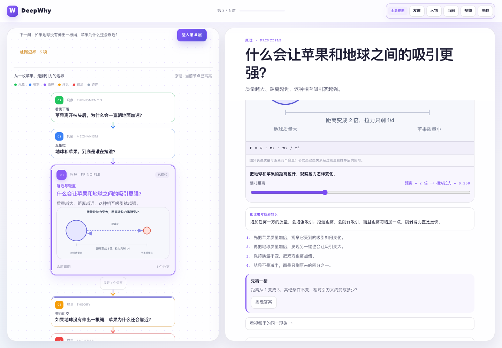

# DeepWhy Skill

An OpenMAIC-inspired, analogy-first agent skill for building interactive,
standalone knowledge-chain pages.

DeepWhy turns a complex question into a causal learning sequence: a familiar
scene, one usable metaphor, animated causal mapping, a hands-on lab, reflection,
targeted videos, a five-question check, and a clearly stated boundary. The
generated page works as one portable HTML file without the DeepWhy application.

<p align="center">
  <a href="skills/deepwhy/examples/apple-gravity.html">
    <picture>
      <source srcset="docs/assets/deepwhy-interactive-preview.webp"
              type="image/webp">
      
    </picture>
  </a>
</p>

<p align="center">
  <sub>Preview: navigate the knowledge chain, then move the distance slider to
  see the curve and relative force update together.
  <a href="skills/deepwhy/examples/apple-gravity.html">Open the full example</a>.</sub>
</p>

## What it creates

- A three-to-six-node knowledge chain from phenomenon to mechanism, principle,
  theory, frontier, or boundary.
- One dominant visual focal point and a desktop node-graph learning workbench.
- Sandboxed interactive labs with completion, reset, reflection, and fallback.
- Five single-choice questions per node with immediate green/red feedback,
  explanations, persistent state, and an answer card.
- Five distinct external videos per node with one primary player and four
  thumbnail choices.
- A global view for development history, related people, current stage, the full
  video library, and a global quiz.
- A single shareable HTML page with embedded CSS, JavaScript, diagrams, and
  optional Manim media.

See [skills/deepwhy/SKILL.md](skills/deepwhy/SKILL.md) for the complete workflow.

## Install

### Codex

```bash
git clone https://github.com/deepwhy/deepwhy-skill.git
mkdir -p ~/.codex/skills
cp -R deepwhy-skill/skills/deepwhy ~/.codex/skills/deepwhy
```

Windows PowerShell:

```powershell
git clone https://github.com/deepwhy/deepwhy-skill.git
New-Item -ItemType Directory -Force "$HOME\.codex\skills"
Copy-Item -Recurse -Force "deepwhy-skill\skills\deepwhy" "$HOME\.codex\skills\deepwhy"
```

Then invoke:

```text
$deepwhy 为什么计算机使用补码？
```

### Other agent runtimes

DeepWhy is not tied to Codex. The reusable interface is the directory containing
[SKILL.md](skills/deepwhy/SKILL.md), along with its `references/`, `scripts/`,
and `assets/` folders.

- If your agent supports `SKILL.md`, install `skills/deepwhy` into that runtime's
  skill directory. Directory names vary by product, so follow the runtime's own
  installation convention.
- If it supports `AGENTS.md`, clone this repository and work inside it; the root
  [AGENTS.md](AGENTS.md) routes knowledge-explainer requests to the Skill.
- If it has no Skill mechanism, point it at the files directly:

```text
Read skills/deepwhy/SKILL.md and follow it to generate an interactive,
standalone HTML knowledge chain for this question: <question>
```

`agents/openai.yaml` is optional Codex interface metadata. Other runtimes can
ignore it.

## Requirements

- Python 3.10+ for validation and page building.
- Node.js 20+ only when running the optional Playwright browser test.
- Manim is optional. The Skill asks for explicit confirmation before installing
  an isolated runtime; otherwise it uses SVG/SMIL fallback.
- External papers and embedded videos require network access. The generated
  HTML itself works offline.

## Generate a page

From the Skill directory:

```bash
python3 scripts/validate_content.py assets/apple-gravity.example.json
python3 scripts/build_page.py \
  assets/apple-gravity.example.json \
  --output /tmp/apple-gravity.html
```

## Example

The generated example is
[examples/apple-gravity.html](skills/deepwhy/examples/apple-gravity.html).
It includes the source JSON, a real Manim scene, WebM/WebP assets, five questions
per node, and 30 distinct external video records.

## Test

```bash
python3 skills/deepwhy/scripts/validate_content.py \
  skills/deepwhy/assets/apple-gravity.example.json
python3 -m unittest discover \
  -s skills/deepwhy/tests -p 'test_*.py' -v
node skills/deepwhy/tests/browser_test.mjs \
  skills/deepwhy/examples/apple-gravity.html
```

The browser test requires Playwright and a Chromium executable. GitHub Actions
runs the platform-independent Python checks on every push and pull request.

## Repository layout

```text
deepwhy-skill/
|-- AGENTS.md
|-- README.md
|-- LICENSE
|-- .github/workflows/tests.yml
`-- skills/deepwhy/
    |-- SKILL.md
    |-- agents/
    |-- assets/
    |-- examples/
    |-- references/
    |-- scripts/
    `-- tests/
```

## License

MIT. See [LICENSE](LICENSE).
